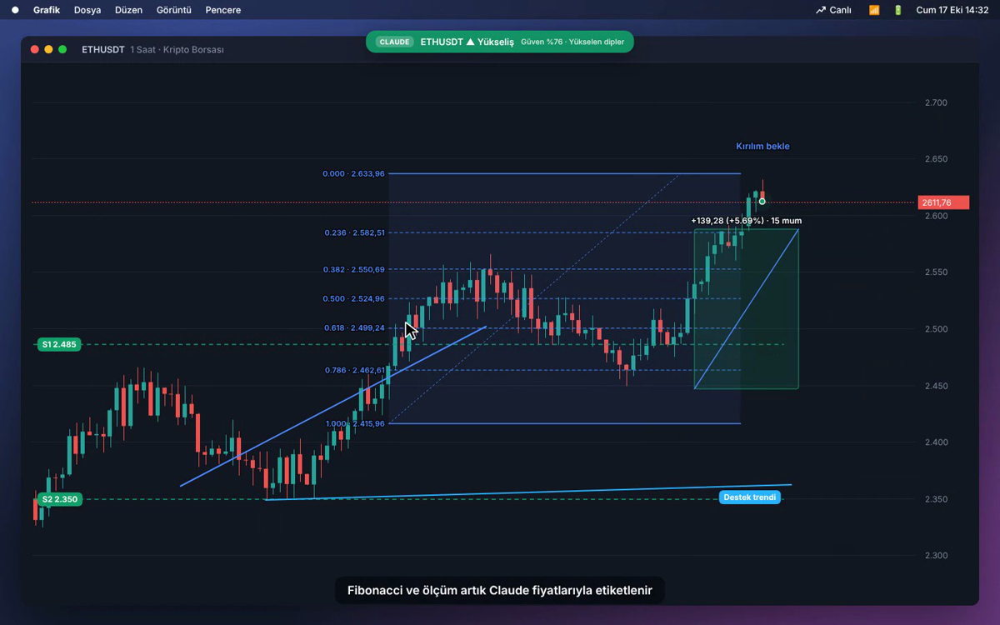
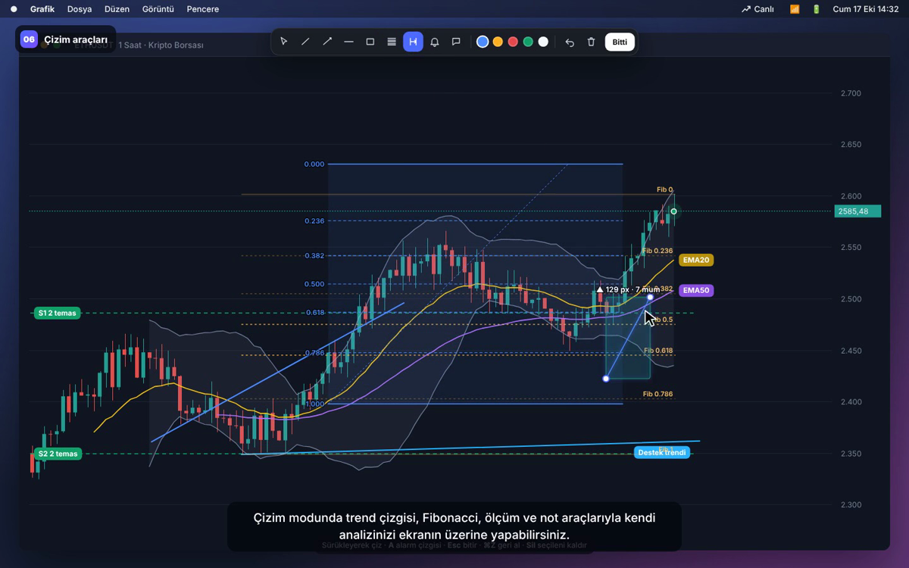

# Grafik Okuyucu

Ekrandaki fiyat grafiğini (TradingView, Matriks, broker ekranları, tarayıcı…) okuyan macOS menü çubuğu uygulaması. Destek/direnç seviyelerini, trend çizgilerini, yönü ve formasyonları bulur; hepsini doğrudan grafiğin üstüne çizer. Ekrana kendi çizimlerini de yapabilirsin.



Tanıtım videosu (seslendirmeli): [docs/demo.mp4](docs/demo.mp4)

## İki analiz motoru

| | ⚡ Hızlı (yerel) | ✦ Claude AI |
|---|---|---|
| Ücret | **Ücretsiz**, API anahtarı gerekmez | Analiz başına ~$0,001 (Haiku 5.5) |
| Hız | Anında, çevrimdışı | 2–6 sn |
| Ne okur | Mumların konumu: destek/direnç (temas sayısıyla), trend çizgileri, trend yönü, ikili tepe/dip, kırılım | Ayrıca fiyat ekseni, sembol, zaman dilimi, formasyonlar ve yorum |
| Canlı mod | Varsayılan; her 2 sn | İsteğe bağlı (Ayarlar › Canlı modda Claude kullan) |

Hızlı motor yeşil/kırmızı mum grafiklerinde çalışır; çizgi grafikler için Claude kullan.

### Claude için ücret

Claude API aylık abonelik değil, **önceden ödemeli kredi** ile çalışır:

1. [console.anthropic.com](https://console.anthropic.com) adresinde hesap aç.
2. **Billing** bölümünden tek seferlik kredi yükle (en az $5).
3. **API Keys** bölümünden anahtar oluştur ve uygulamada Ayarlar sekmesine yapıştır.

Varsayılan model Haiku 5.5 ile $5 kabaca 4.000–5.000 analize yeter. Uygulama bu ayki harcamayı Ayarlar sekmesinde gösterir. claude.ai Pro aboneliği API kredisi içermez.

## Analiz

Her analizde (Hızlı ve Claude) şunlar hesaplanır:

- **Destek / direnç** seviyeleri ve temas sayıları, **trend çizgileri**
- **İndikatörler:** RSI (14), MACD (12, 26, 9), EMA 20/50, Bollinger (20, 2)
- **Mum formasyonları:** yutan boğa/ayı, çekiç, kayan yıldız, sabah/akşam yıldızı, doji
- **RSI uyumsuzluğu**, ikili tepe/dip, kırılım tespiti
- **Otomatik Fibonacci** (son büyük salınım)
- **Teknik görünüm skoru** (-100…+100) ve her faktörün katkısı
- **Risk/ödül oranı** (en yakın direnç ve destek arası)

Fiyat ekseni okunmadan, mumların ekrandaki konumundan hesaplanır; EMA, Bollinger, MACD ve RSI bu dönüşümden etkilenmez. Claude analizi fiyatları ekler ve skora kendi yorumunu katar.

## Telegram derinlik botu

Kullandığın Telegram derinlik botunu uygulamaya bağlayabilirsin:

1. [my.telegram.org](https://my.telegram.org) › **API development tools** bölümünden `api_id` ve `api_hash` al.
2. Ayarlar › **Telegram derinlik botu** kartına bunları, botun kullanıcı adını ve komutu yaz (`{KOD}` hisse koduyla değişir, ör. `/derinlik {KOD}`), **Bağlan**'a bas. Telegram'a gelen kodu gir.
3. **Derinlik** sekmesinde hisse kodunu yazıp **Getir**'e bas ya da otomatik yenilemeyi aç.

Uygulama bota senin hesabınla mesaj atar, cevabı ayrıştırır ve:

- **Derinlik kademeleri**, **aracı kurum dağılımı** (alıcılar/satıcılar) ve **gerçekleşen işlemleri** listeler
- Grafikte biriken emirlere **"▲ Alış duvarı 4,3M lot @ 12,13"** gibi etiketler, en çok alan/satan kurumun **maliyet çizgisini** çizer (fiyat ölçeği için bir kez Claude analizi gerekir)
- **Al/sat baskısını** (-100…+100) derinlik dengesi, alış/satış oranı, kurum net akışı ve işlemlerden hesaplar; her yenilemede kaydedip **trendini** gösterir ("Alış baskısı artıyor")
- Bot resim gönderirse Claude ile okur, web terminali butonunu uygulama içinde açar

Telegram yoksa **Ekrandan** kaynağı, açık olan derinlik terminalini Claude ile okur. Oturum ve `api_hash` Anahtar Zinciri ile şifreli saklanır.

## Özellikler

- **⌘⇧A** analiz, **⌘⇧D** çizim modu, **⌘⇧L** canlı mod
- Canlı mod: 2 sn – 1 dk aralıkla yeniden okur, ekran değişmediyse hiçbir şey yapmaz
- Kırılım bildirimleri: son fiyat bir seviyeyi kırınca macOS bildirimi
- **Alarm çizgisi** (çizim modunda A): fiyat çizgiyi geçince bildirim; canlı mod otomatik açılır
- Grafikte EMA, Bollinger ve otomatik Fibonacci gösterimi (Ayarlar › Grafikte göster)
- Analizi tek tıkla panoya kopyalama, oturum açılınca başlatma
- Çizim araçları: trend, ışın, yatay çizgi, dikdörtgen, Fibonacci, ölçüm, alarm, not. Renk seçimi, geri alma, taşıma ve silme; çizimler ekran başına kaydedilir
- Claude analizinden sonra Fibonacci, yatay çizgi ve ölçüm araçları fiyatla etiketlenir
- Claude'a yalnızca grafik alanı gönderilir (daha az token, daha net okuma)
- Fare imlecinin bulunduğu monitörü okur
- API anahtarı macOS Anahtar Zinciri ile şifreli saklanır
- Son 30 analizin geçmişi, açık/koyu tema



## Geliştirme

```bash
npm install
npm start          # uygulamayı çalıştır
npm run dist       # dist/ altına .dmg üret (macOS)
```

GitHub Actions her push'ta macOS için imzasız bir `.dmg` üretir (Actions › build › Artifacts). İmzasız uygulamayı ilk açışta Finder'da sağ tık › **Aç** demen gerekir. Her yeni derlemede Ekran Kaydı iznini yeniden vermen gerekebilir.

| Dosya | Görev |
|---|---|
| `main.js` | Menü çubuğu, kısayollar, ekran görüntüsü, canlı mod, bildirimler, ayarlar |
| `engine.js` | Yerel mum grafiği okuyucu (piksel analizi) |
| `ai.js` | Claude API isteği ve maliyet hesabı |
| `tg.js` | Telegram bağlantısı (GramJS) |
| `depth.js` | Derinlik verisi ayrıştırma, duvarlar, al/sat baskısı ve trendi |
| `preload.js` | Pencerelere açılan sınırlı API |
| `popup.html` | Menü çubuğu penceresi (Analiz / Geçmiş / Ayarlar) |
| `overlay.html` | Ekrana çizilen analiz katmanı ve çizim araçları |

> Bu uygulama yatırım tavsiyesi vermez; analizler hatalı olabilir.
