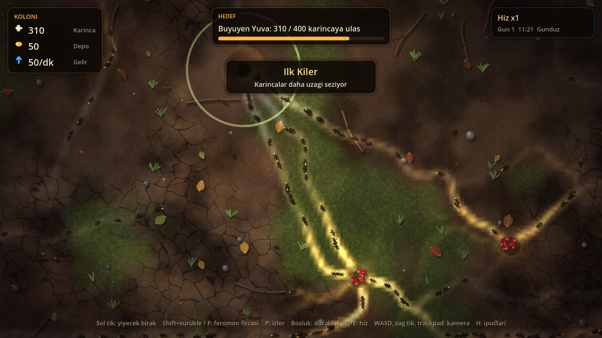
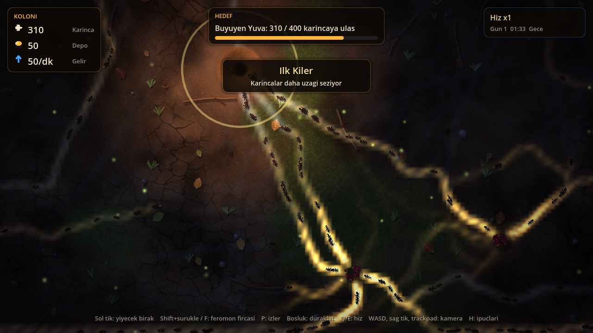

# Koloni — Oyun Tasarım Belgesi (demo v0.3)

> Hedef cihaz: **MacBook Neo** (Apple A18 Pro, 8 GB birleşik bellek, fansız, entegre GPU).
> Motor: **Godot 4.4+** (Metal destekli Mobile renderer). Tür: üstten görünümlü 2D koloni yönetimi.

## 1. Tek cümlelik fikir
Yüzlerce karıncanın feromon izleriyle kendi kendine yol bulduğu canlı bir toprak altı/üstü dünyasında,
oyuncu doğrudan karınca sürmez; **koloniyi yönlendirir**: kaynak açar, rol dağıtır, tehditlere karşı yuvayı büyütür.

## 2. Oyuncu deneyimi ve sütunlar
1. **İzlemesi keyifli kaos.** Karıncalar ortaya çıkan (emergent) davranış sergiler; altın yiyecek izleri ve mavi yuva izleri ekranda yaşayan bir harita çizer.
2. **Dolaylı kontrol.** Oyuncu emir vermez, koşulları değiştirir: yiyecek bırakır, feromon boyar, oda kazdırır.
3. **Sakin ama derin.** Kısa oturumlar (10–20 dk) için uygun, pil dostu, fansız cihazda sessiz.

## 3. Çekirdek döngü
Keşfet → İz oluştur → Topla → Kilere taşı → **Harca** (yumurta, asker, yükseltme) → Daha uzağa keşfet.
Gerilim iki yerden gelir: koloni her saniye yer (kiler boşalırsa karıncalar ölür) ve geceleri örümcek gelir. Kiler hem para hem hayat; her harcama bir risk.

### Demo akışı (5 bölüm, ~10–15 dk)
1. **İlk hasat**: kilere 40 yiyecek.
2. **Yuvayı büyüt**: ilk yumurtayı al.
3. **Nöbetçiler**: 6 asker yetiştir.
4. **Örümcek**: gece gelen örümceği askerlerle öldür (+40 yiyecek). Bölüm başladıktan sonraki her gece bir örümcek gelir, şafakta çekilir.
5. **Kışa hazırlık**: 500 karınca → demo sonu ekranı.
Kaybetme: 40 karıncanın altına düşmek. R ile yeniden başlanır. Rehber satırı oyuncu her adımı yapana kadar ne yapacağını söyler.

## 4. Sistemler
| Sistem | Durum (v0.2) | Sonraki adım |
|---|---|---|
| Karınca davranışı | Arama/dönüş, 3 sensörlü feromon takibi, gezinme, kenarda yansıma | Roller: işçi, asker, kaşif; yorgunluk |
| Feromon alanı | 2 katman, 8 px hücre, 10 Hz buharlaşma, yumuşak bırakma; oyuncu fırçası (Shift+sürükle / F) | Tehlike feromonu |
| Yiyecek | Tohum/meyve/yaprak türleri, ilk keşifte bildirim, sol tık ile bırakma | Çürüme, büyük av (birlikte taşıma) |
| Yuva | Teslimat, doğum, nabız ışığı | Yeraltı kesiti, odalar |
| İlerleme | 5 hikâye bölümü, başlık ve demo sonu/kaybetme ekranları | Kraliçe yükseltme ağacı, mevsimler |
| Kiler ekonomisi | Açlık (asker 3 kat yer), yumurta / asker / keskin koku / uzun bacak; her alım fiyatı artırır (yumurta %10, asker %20, yükseltme %60) | Oda inşası |
| Tehdit | Örümcek (gece, işçi avlar, askerler öldürür), açlık | Rakip koloni, yağmur |
| Gün döngüsü | 180 sn'lik gün, gece mavi ton, ateşböcekleri, yuva ışığı, gün sayacı | Gece karıncalar yavaşlar |
| Ses | Prosedürel efektler + gündüz/gece ambiyansı (`tools/gen_audio.py`) | Müzik katmanları |

## 5. Kontroller (MacBook odaklı)
- Trackpad: iki parmak kaydırma = kamera, sıkıştırma = yakınlaştırma (Magnify/Pan gesture destekli).
- Klavye: WASD/oklar kamera, Boşluk duraklat, Q/E hız (x1–x8), P feromon katmanı.
- Fare: sol tık yiyecek bırak, Shift+sürükle (veya F) feromon fırçası, sağ tık sürükle. H ipuçları.

## 6. Görsel stil
Ayrıntılı kurallar: `.claude/skills/koloni-gorsel-stil`. Özet: "makro fotoğraf, sıcak orman zemini"; doku dosyası yok, her şey prosedürel.
- **Zemin:** fbm toprak, kurumuş bölgelerde voronoi çatlaklar, yosun/nem lekeleri, parlak kum taneleri, yuva çevresinde kazı halkası ve AO.
- **Dekor:** düşmüş yapraklar (damarlı), dallar, taşlar, çimen tutamları; gölgeli, bir kez çizilir.
- **Karıncalar:** 14 px, baş/göğüs/bel/karın + anten + çene, ışık yönünde parlak gövde. Bacaklar 3'lü tripod yürüyüşüyle GPU'da hareket eder (`ant.gdshader`); yük taşıyan karıncanın ağzında altın tohum. Tek tampon, iki MultiMesh (gövde + gölge).
- **Feromon:** eklemeli parıltı, yoğun izin çekirdeği beyaza kayar, iz boyunca akan ışıltı; gece daha parlak.
- **Atmosfer:** rüzgârla kayan kanopi gölgeleri, gündüz toz zerreleri, gece ateşböcekleri, ekran vinyeti.
- **Geri bildirim:** yiyecek "pop" animasyonu, keşif/doğum/kilometre taşı halkaları, yuvada "+N" yazıları, kamera nabzı, kayan bildirimler.

## 7. Performans bütçesi (MacBook Neo, 60 FPS = 16.6 ms)
| Kalem | Bütçe | Not |
|---|---|---|
| Simülasyon (GDScript) | ≤ 4 ms @ 600 karınca | Ölçüm: ~1.8 ms/adım @ 200–400 karınca (Linux CI) |
| Feromon buharlaşma + doku yükleme | ≤ 1 ms, 10 Hz | `PackedFloat32Array.to_byte_array()` ile kopyasız yükleme |
| Çizim çağrısı | < 40 | Zemin 1, dekor ~1, feromon 1, karınca 2 (ortak tampon), yuva 1, yiyecek 1, kanopi 1, vinyet 1, parçacık ≤26, arayüz |
| GPU | Tam ekran 4 geçiş (zemin, feromon, kanopi, vinyet) | Retina'da gerekirse zemin shader'ı yarım çözünürlüklü SubViewport'a alınır |
| Bellek | < 300 MB | Doku dosyası yok |

Kurallar: gerçek zamanlı gölge yok, `GPUParticles2D` yerine havuzlu CPU parçacık, tam ekran post-process yok, 60 FPS sınırı (pil/ısı).
Karınca sayısı 1000'i geçerse simülasyon GDExtension (C++) ya da compute shader'a taşınır; `colony_sim.gd` bunun için çizimden ayrı tutuldu.

## 8. Ses
Gündüz rüzgâr/yaprak, gece cırcır böceği ambiyansı (çapraz geçiş); yiyecek alma "tık", bırakma, doğum, keşif ve kilometre taşı çanları. 6 kanallı havuz, 80 ms spam engeli, ±%8 perde. Kurallar: `.claude/skills/koloni-arayuz-ses`.

## 9. Kilometre taşları
1. **v0.1:** çalışan sahne, feromon davranışı, gün döngüsü, testler.
2. **v0.2:** görsel yenileme, yürüme animasyonu, atmosfer, ses, feromon fırçası.
3. **v0.3 (bu sürüm):** oynanabilir demo: kiler ekonomisi, açlık, asker rolü, örümcek, 5 bölüm, Mac çıktısı.
4. **v0.4:** yeraltı kesiti ve odalar, kaydet/yükle.
5. **v0.5:** müzik, menü, macOS imzalı dışa aktarım, MacBook Neo'da profil ölçümü.

## 10. Açık sorular
- Yeraltı görünümü ayrı sahne mi, aynı haritada katman mı?
- Hedef oturum: sonsuz sandbox mu, senaryolu bölümler mi?
